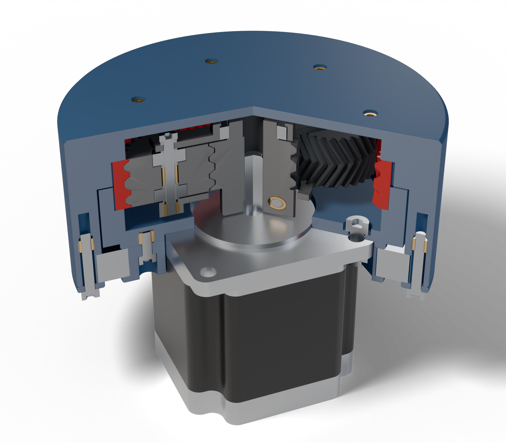
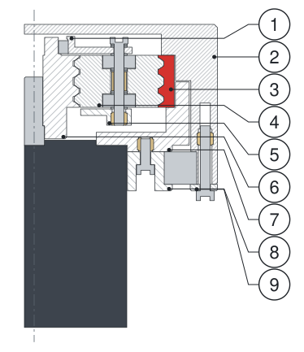
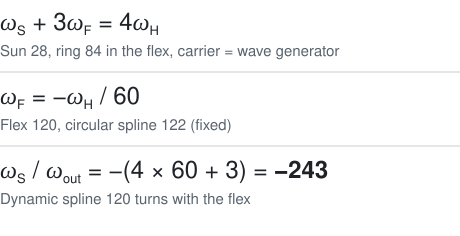
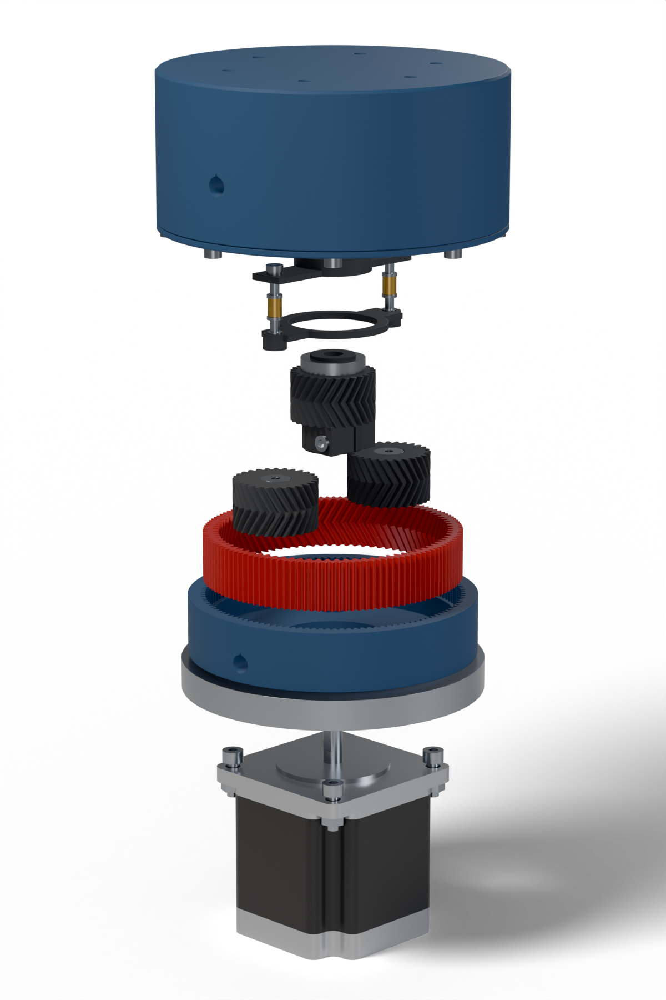
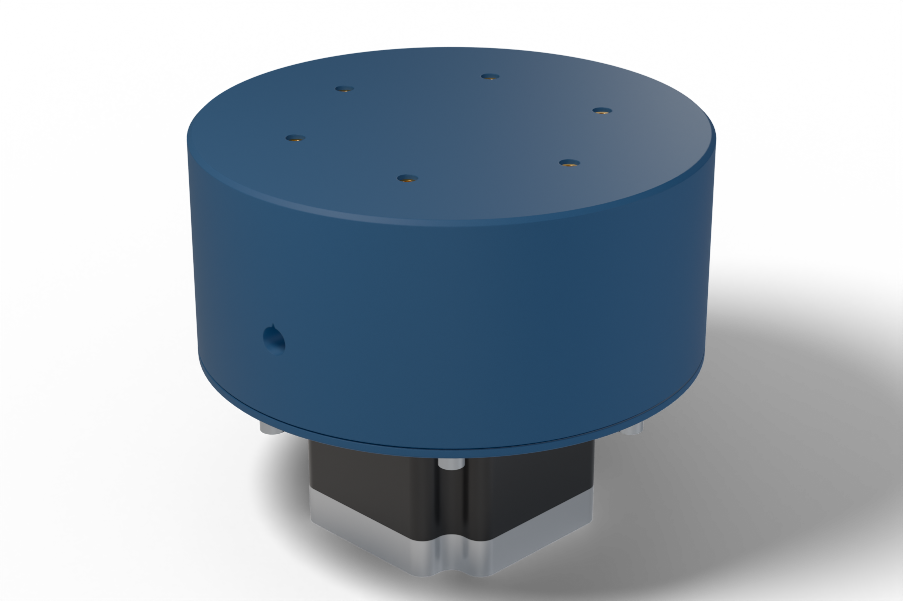

# Strain-wave drive

<picture><source media="(prefers-color-scheme: dark)" srcset="images/planetary-cutaway-dark.png"></picture>

A 3D-printed strain-wave (harmonic) drive that wraps around a NEMA 23 stepper motor: the motor sits inside the output bearing, not behind the gearbox. A planetary stage inside the flexspline gives <!-- generated:ratio-planetary -->−243 : 1<!-- /generated -->; the plain preset drives the flex with four 623 rollers on the motor shaft for <!-- generated:ratio-plain -->−60 : 1<!-- /generated --> in the same package. Parametric CadQuery source regenerates every part, the STEP assembly, the STL and 3MF print files and the bill of materials.

[STEP assembly](models/planetary/planetary-assembly.step) · [Print files](models/planetary/print/) · [Bill of materials](models/planetary/bom.csv) · [Plain preset files](models/plain/)

<!-- generated:summary -->

|  | Planetary | Plain |
| --- | ---: | ---: |
| Ratio | −243 : 1 | −60 : 1 |
| Size above the motor face | Ø112.8 × 37.2 mm | Ø112.8 × 37.2 mm |
| Height with motor | 93.2 mm | 93.2 mm |
| Printed parts | 10 | 7 |
| Catalog hardware | 69 items, 13 part numbers | 62 items, 10 part numbers |
| Machined parts | 0 | 0 |

<!-- /generated -->

## Mechanism

<picture><source media="(prefers-color-scheme: dark)" srcset="images/section-planetary-dark.svg"></picture>

A thin PA6 flexspline ring with <!-- generated:flex-teeth -->120<!-- /generated --> external teeth sits inside two rigid internal gears. The lower band meshes with the fixed circular spline (<!-- generated:circular-teeth -->122<!-- /generated --> teeth, bolted to the motor). The upper band meshes with the dynamic spline (<!-- generated:flex-teeth -->120<!-- /generated --> teeth), which is part of the output drum. The wave generator presses the flex into two lobes, so it meshes only near the major axis. Each turn of the wave generator walks the flex <!-- generated:tooth-difference -->2<!-- /generated --> teeth around the fixed spline; the dynamic spline has the same tooth count as the flex and turns with it.

The wave generator is a planetary stage. The sun gear clamps to the motor shaft, two planets ride on a carrier, and the planets mesh with the <!-- generated:ring-teeth -->84<!-- /generated -->-tooth herringbone ring cut into the bore of the flex. The planets press the flex outward from inside, and the carrier sets the orientation of the wave.

<!-- generated:section-parts -->

|  | Part | Material |
| ---: | --- | --- |
| 1 | Upper planetary carrier and bearing shoulder | CF-PLA |
| 2 | Dynamic spline and output drum | CF-PLA |
| 3 | PA6 flexspline | PA6 |
| 4 | Planet gear | CF-PLA |
| 5 | Lower planetary carrier | CF-PLA |
| 6 | Sun gear and split shaft clamp | CF-PLA |
| 7 | Circular spline and motor plate | CF-PLA |
| 8 | Motor-wrap journal with lower inner-race shoulder | CF-PLA |
| 9 | Output bearing lower outer-race cap | CF-PLA |

<!-- /generated -->

## Ratio

<picture><source media="(prefers-color-scheme: dark)" srcset="images/ratio-planetary-dark.svg"></picture>

ω is angular velocity: S sun (motor), H carrier (wave generator), F flex, out output drum. The first line is the planetary stage, with the flex as its ring gear. The second is the strain-wave stage: each wave revolution turns the flex back by its tooth difference to the fixed spline. The output drum turns with the flex. The plain preset drives the wave generator directly: <!-- generated:plain-ratio -->−120 / (122 − 120) = −60 : 1<!-- /generated -->.

## Fit-test coupons

Print these before the drive, from [`models/coupons/print/`](models/coupons/print/). Each family tests one fit at the default and at values either side. Set the named parameter to the value that fits your printer and hardware, then regenerate.

<!-- generated:coupons -->

| Coupon | Prints | Material | What it settles |
| --- | ---: | --- | --- |
| Tooth flex plain | 1 | PA6 | Print flat, then ovalize this 3 mm PA6 ring into each matching rigid ring. Set tooth_offset from the least tight pair that turns without tooth skipping. |
| Tooth ring plain | 3 | CF-PLA | Print flat. Pair the three plain rings at tooth_offset −0.1, 0 and +0.1 mm with the matching PA6 ring. Select the least tight pair that turns without tooth skipping. |
| Tooth flex planetary | 1 | PA6 | Print flat, then ovalize this 3 mm PA6 ring into each matching rigid ring. Set tooth_offset from the least tight pair that turns without tooth skipping. This does not test the internal herringbone mesh. |
| Tooth ring planetary | 3 | CF-PLA | Print flat. Pair the three planetary rings at tooth_offset −0.1, 0 and +0.1 mm with the matching PA6 ring. Select the least tight pair that turns without tooth skipping. |
| Fits plate | 3 | CF-PLA | Print flat. Three plates test offsets −0.1, 0 and +0.1 mm: bearing_offset for the 125 mm seat, 80 mm ribbed journal, 21 mm seat and 14.9 mm journal; roller_pocket_offset for the 623 pocket; insert_offset for the insert pilot; motor_pilot_offset for the boss; shaft_offset for the D bore. The separate 4.4 mm pilot tests insert_offset=+0.2. Use the actual hardware. |
| Output seat | 3 | CF-PLA | Print flat. The three short 100 mm seats test bearing_offset −0.1, 0 and +0.1 mm with the actual 6816 bearing. Ribs may compress, but the bearing must seat without splitting the ring. |
| Motor corner | 3 | CF-PLA | Print flat. The three collars test motor_clearance 0.1, 0.2 and 0.3 mm. Fit an 80 mm bore bearing over each collar, then slide it over the front of the motor. Reject binding or cracked corner walls. |
| Axial cavity | 3 | CF-PLA | Print with the gap axis vertical and remove the upper-beam supports. Trial the conditioned PA6 gauge in all three frames at flex_axial_clearance 0, 0.1 and 0.2 mm; choose the smallest gap that does not bind. |
| Axial flex gauge | 1 | PA6 | Print the 16 mm height vertically, dry and condition it like the final flex, then trial all axial frames to select flex_axial_clearance. This sector checks axial fit, not internal gear mesh. |
| Shaft clamp gauge | 1 | CF-PLA | Print shaft-axis vertical; install one RX-M3x5x4 and an M3×16 screw. Trial the actual shaft and compare the fit plate to select shaft_offset and insert_offset. The lower round relief clears the unflattened shaft base. |
| Shaft access frame | 1 | CF-PLA | Mount this frame to the motor face and place the clamp gauge on the shaft. A 2.5 mm hex key must turn freely through both 6.1 mm ports. If the key is blocked, report it: no offset fixes this. |

<!-- /generated -->

## Printed parts

Every part: <!-- generated:print-settings -->0.16 mm layers, 6 walls, 100% infill<!-- /generated -->. Rigid parts are carbon-fibre PLA; dry the PA6 before printing the flexspline. Masses are solid-volume estimates, not slicer weights.

<!-- generated:printed-parts -->

| Part | Qty | Material | Mass (g) | Supports | Orientation |
| --- | ---: | --- | ---: | --- | --- |
| Circular spline and motor plate | 1 | CF-PLA | 67.7 | bed-only beneath motor-plate overhang | Motor mounting face down; bearing shoulder below it needs accessible bed support. |
| Motor-wrap journal with lower inner-race shoulder | 1 | CF-PLA | 26 | none | Flat face on the bed; axis vertical. |
| Dynamic spline and output drum | 1 | CF-PLA | 217.4 | none | Closed roof on the bed, open bearing skirt upward. |
| Output bearing lower outer-race cap | 1 | CF-PLA | 6.7 | none | Flat face on the bed; axis vertical. |
| PA6 flexspline | 1 | PA6 | 14.3 | none | Axis vertical; dry PA6. The print mesh is the neutral circular ring, never its operating deformation. |
| Sun gear and split shaft clamp | 1 | CF-PLA | 14.3 | accessible bed-only support below gear and clamp | Shaft axis vertical; lower hub end on bed. |
| Lower planetary carrier | 1 | CF-PLA | 1.7 | accessible bed-only support beneath bridge | Insert bosses on bed; remove bridge supports before installing inserts. |
| Upper planetary carrier and bearing shoulder | 1 | CF-PLA | 2 | none | Flat face on the bed; axis vertical. |
| Planet gear 1 | 1 | CF-PLA | 9.4 | none | Flat face on the bed; axis vertical. |
| Planet gear 2 | 1 | CF-PLA | 9.4 | none | Flat face on the bed; axis vertical. |

<!-- /generated -->

## Hardware

<!-- generated:hardware -->

| Qty | Part | Vendor | Part number | Size |
| ---: | --- | --- | --- | --- |
| 1 | 23HS22-2804S | StepperOnline | [23HS22-2804S](https://www.omc-stepperonline.com/nema-23-bipolar-1-8deg-1-26nm-178-4oz-in-2-8a-2-5v-57x57x56mm-4-wires-23hs22-2804s) | 57×57×56 body; Ø38.1×1.6 pilot; 47.14 bolt square; Ø6.35×21 D shaft |
| 1 | 6816-2RS | VXB | [6816-2RS](https://vxb.com/products/6816-2rs-sealed-bearing-80x100x10) | 80 × 100 × 10 mm |
| 4 | ISO 4762 M4×12 | McMaster-Carr | [91290A148](https://www.mcmaster.com/91290A148/) | Head Ø7 × 4; socket 3; under-head length 12 mm |
| 4 | ISO 4032 M4 | McMaster-Carr | [90593A003](https://www.mcmaster.com/90593A003/) | Across flats 7 mm; height 3.2 mm; M4×0.7 |
| 21 | Ruthex RX-M3x5x4 | ruthex.de | [RX-M3x5x4](https://www.ruthex.de/en/products/ruthex-gewindeeinsatz-m3-100-stuck-made-for-voron-rx-m3x5x4-messing-gewindebuchsen-fur-3d-druck) | M3; maximum Ø5; entry Ø4.25; length 4 mm |
| 4 | ISO 4762 M3×8 | McMaster-Carr | [91290A113](https://www.mcmaster.com/91290A113/) | Head Ø5.5 × 3; socket 2.5; under-head length 8 mm |
| 8 | ISO 4762 M3×20 | McMaster-Carr | [91290A123](https://www.mcmaster.com/91290A123/) | Head Ø5.5 × 3; socket 2.5; under-head length 20 mm |
| 1 | 6702-2RS | RCBearings | [MDD-6702-2RS](https://rcbearings.com/product/113/) | 15 × 21 × 4 mm |
| 4 | 623ZZ | RCBearings | [MDC-623-ZZ](https://rcbearings.com/product/349/) | 3 × 10 × 4 mm |
| 2 | RAF M0505-3-B | MW Components / RAF | [M0505-3-B](https://www.mwcomponents.com/shop/m0505-3-b) | ID 3.2; OD 4.5; length 6 mm |
| 16 | DIN 988 3×5×0.5 | KB-3D | [SS-3505-50](https://kb-3d.com/store/inserts-fasteners-adhesives/3009-3x5x05mm-shim-ring-washer-pack-of-50-din988-1635423113345.html) | ID 3; OD 5; thickness 0.5 mm |
| 2 | DIN 7984 M3×25 | Accu | [SSCL-M3-25-A2](https://accu-components.com/us/low-head-cap-screws/8730-SSCL-M3-25-A2) | Head Ø5.5×2; socket 2; under-head length 25 mm |
| 1 | ISO 4762 M3×16 | McMaster-Carr | [91290A120](https://www.mcmaster.com/91290A120/) | Head Ø5.5 × 3; socket 2.5; under-head length 16 mm |

<!-- /generated -->

## Assembly

<picture><source media="(prefers-color-scheme: dark)" srcset="images/planetary-exploded-dark.png"></picture> <picture><source media="(prefers-color-scheme: dark)" srcset="images/planetary-hero-dark.png"></picture>

<!-- generated:assembly -->

1. Print the bearing, motor-corner, shaft-access and axial-height coupons; select offsets before printing the drive.
2. Heat-set all inserts. Slide the output bearing onto the journal sleeve from its open upper end; its lower inner-race shoulder is integral.
3. Slide the sleeve/bearing over the front of the motor and park it 18 mm below its final position. Do not pass it over the rear connector.
4. Fasten the circular-spline motor plate with four M4×12 cap screws from above. Hold each exposed rear-flange nut 5° from its corner diagonal before raising the sleeve.
5. Raise the sleeve to the motor plate and tighten its four M3×8 screws from below through the Ø5.8 counterbores.
6. Each planet axle, bottom to top: lower carrier; 1 shim; lower 623ZZ bearing; 2 shims; one 6 mm RAF spacer; 2 shims; upper 623ZZ bearing; 1 shim; upper carrier; 2 shims; DIN 7984 M3×25 screw head. All 8 shims per axle are DIN 988 3×5×0.5 mm. Fit the spacer and its internal shims before seating the second bearing.
7. Slide the 6702 onto the sun shoulder, then assemble the sun, planets and carrier plates outside the drum. The carrier's outer-race shoulder sits above the bearing. Tighten the axle screws against the metal stacks and check free rotation.
8. Place the drum roof-down. Install the flex and assembled carrier through its open bottom, then lower the motor assembly in.
9. Enter the bearing into the drum's ribbed seat; fit the rotating lower outer-race cap and tighten its eight screws from below.
10. With the hex key removed, jog the motor slowly until the V-notched ports and clamp socket line up. Disconnect motor power before inserting the key and tightening the clamp.
11. Attach the payload using the six M3 inserts on a 68 mm pitch circle. Hand-turn through a complete cycle and verify no binding before applying power.

<!-- /generated -->

## Regenerating

Requires Python 3.12 and [uv](https://docs.astral.sh/uv/).

```sh
uv sync
uv run strain-wave-drive                      # planetary, plain and coupons into models/
uv run strain-wave-drive --preset planetary --set bearing_offset=0.05 --set tooth_offset=-0.05
uv run strain-wave-drive --preset planetary --set output_bearing=6016 --out build/6016   # 80×125×22 bearing, Ø137.8 mm
```

A build writes `models/<preset>/`: the STEP assembly, one STEP per part, `print/` STL and 3MF files, `bom.csv`, `print.csv`, a GLB for the viewer and `report.json` with every check. A value outside its range stops the build with the reason. The planetary preset builds in about <!-- generated:build-seconds -->174<!-- /generated --> s on an Apple silicon Mac.

<!-- generated:parameters -->

| Parameter | Default | Range | Meaning |
| --- | ---: | --- | --- |
| `motor_clearance` | 0.2 | 0.1 to 0.3 mm | Normal clearance around the motor body inside the journal sleeve. |
| `flex_teeth` | 120 | 80 to 240 teeth | External flex tooth count; circular spline has two more. |
| `module` | 0.7 | 0.4 to 1.2 mm | External tooth pitch diameter divided by tooth count. |
| `flex_wall` | 1.629 (plain 1.5) | 1.2 to 4 mm | Minimum radial wall from external root to the deepest bore or inner tooth root. |
| `flex_height` | 16 | 16 to 32 mm | Axial flex height; sun and planet faces span this complete height. |
| `flex_axial_clearance` | 0 | 0 to 1 mm | Total axial cavity clearance beyond the flex height. |
| `roller_preload` | 0.7 | 0 to 1.4 mm | Radial intrusion of the plain roller envelope into the circular flex bore. |
| `planet_preload` | 0.105 | 0 to 0.5 mm | Holder-axis excess over the nominal ring-to-planet pitch distance. |
| `sun_teeth` | 28 | 20 to 60 teeth | Sun tooth count of the internal planetary stage. |
| `planet_teeth` | 28 | 20 to 60 teeth | Tooth count of each of the two opposed planets. |
| `helix_angle` | 30 | 10 to 40° | Helix angle of each opposed herringbone half. |
| `tooth_offset` | 0 | −0.1 to 0.1 mm | Additional tangential width of each rigid tooth slot. |
| `bearing_offset` | 0 | −0.1 to 0.1 mm | Diametral adjustment of bearing seats and journals; positive loosens both. |
| `roller_pocket_offset` | 0 | −0.1 to 0.1 mm | Diametral adjustment of printed 623 bearing pockets. |
| `insert_offset` | 0 | −0.1 to 0.2 mm | Diametral adjustment of the 4.2 mm heat-set pilot. |
| `motor_pilot_offset` | 0 | −0.1 to 0.1 mm | Diametral adjustment of the 38.2 mm motor register. |
| `shaft_offset` | 0 | −0.1 to 0.1 mm | Diametral D-bore adjustment; the flat moves by half the offset. |

<!-- /generated -->

After a build, refresh the images and this README's tables:

```sh
uv run python tools/render/render_images.py planetary   # images/; needs Blender 4.5 or newer
uv run python tools/readme.py                           # the generated blocks of README.md
```

The animated viewer in `viewer/` plays the generated models. Serve the repository root and open `/viewer/`:

```sh
python3 -m http.server 8000    # then http://localhost:8000/viewer/
```

## Fits against the printed prototype

The tooth forms, preloads and bearing fits come from a prototype that was printed and ran in January 2026. The generator reproduces them at its defaults, and `report.json` compares each one on every build. Millimetres unless stated.

<!-- generated:fits -->

| Fit | Prototype | Generated |
| --- | --- | --- |
| Module and tooth counts | module 0.7, flex teeth 120, circular teeth 122, dynamic teeth 120 | 0.7, 120, 122, 120 |
| Flex tooth form | root chord 1.4, tip chord 0.35, radial addendum 1.54 | 1.4, 0.35, 1.54 |
| Circular slot form | mouth width 1.25, root width 0.55, depth 1.46 | 1.25, 0.55, 1.46 |
| Dynamic slot form | mouth width 1.25, root width 0.61 | 1.25, 0.61 |
| Flex external diameters | root diameter 82.85, tip diameter 85.931 | 82.85, 85.931 |
| Rigid internal diameters | tip diameter 84, root envelope 86.923 | 84, 86.923 |
| Undeformed radial tooth clearances | tip to slot floor 0.495 | 0.495 |
| Herringbone flex wall and bore | minimum web 1.629, height 16, internal root diameter 79.592 | 1.629, 16, 79.592 |
| Planetary tooth system | sun teeth 28, planet teeth 28, ring teeth 84, normal module 0.804, helix angle deg 30 | 28, 28, 84, 0.804, 30 |
| Planetary radial preload | holder axis radius 26.1, radial clearance −0.105 | 26.1, −0.105 |
| Planet bearing pockets | pocket diameter 10.2, pocket depth 4.2 | 10.2, 4.2 |
| Sun D-shaft fit | diameter 6.45, flat 2.725 | 6.45, 2.725 |
| Output outer-race fit | base diametral clearance 0.6, crest diametral clearance −0.219 | 0.6, −0.219 |
| Output inner-race fit | base journal 79.6, crest journal 80.4 | 79.6, 80.4 |
| Circular spline pilots | minimum pilot 4.2, maximum pilot 4.2, minimum depth 4.5, maximum depth 4.5 | 4.2, 4.2, 4.5, 4.5 |
| M3 clearance holes | minimum hole 3.2, maximum hole 3.2 | 3.2, 3.2 |
| Motor pilot register | pilot bore 38.2 | 38.2 |
| Motor mounting holes | square pitch 47.14, minimum hole 5.2, maximum hole 5.2 | 47.14, 5.2, 5.2 |
| Motor screw head recesses | minimum diameter 8.6, maximum diameter 8.6 | 8.6, 8.6 |

<details><summary>Changed from the prototype (29)</summary>

| Fit | Change |
| --- | --- |
| Tooth bands above motor face | The compact package uses two 7.8 mm tooth bands with 0.4 mm axial separation by default. |
| Plain flex wall, bore and height | The plain preset uses the prototype smooth-bore flex; the planetary preset uses its herringbone alternative. |
| Intermediate Flexspline_v2 | The intermediate 16.6 mm internally toothed flex is excluded in favour of the two 16 mm prototype variants. |
| Plain roller preload | The plain preset retains roller preload; the planetary preset uses geared preload instead. |
| Plain axle bores and roller window | A split hub and cap with 0.5 mm inner-race end shims replace the open carrier windows to clamp the axles without dragging the rollers. |
| Carrier center counterbore | A split D-shaft clamp replaces the flange coupling; its lower 4 mm is round because the motor flat starts 6 mm above the mounting face. |
| Planet-to-flex axial coverage | Planet face width is 16 mm instead of the prototype 11 mm; the 16 mm default spans the full flex height. |
| Holder axle holes and center clearance | The split carrier uses Ø3.2 axle clearance and Ø4.2 insert pilots for the catalog M3 clamp screws. |
| Output bearing identity | The selected 6816-2RS is 80×100×10 mm; the 6016 option retains the prototype 80×125×22 mm bearing size. |
| Output bearing axial capture | Opposing shoulders capture the selected catalog bearing width, replacing the prototype end-cap alternatives; trial the actual bearing before tightening the cap. |
| Central bearing identity | A 6702 carrier-to-sun support replaces the prototype 6706 carrier-to-output support, removing the bearing connection to the output. |
| Central bearing outer-race fit | The Ø21 support seat uses 25 Ø0.8 crush ribs and an upper outer-race shoulder opposed by a lower sun shoulder. |
| Central bearing journal fit | The 15 mm support bearing uses a 14.9 mm clearance journal instead of the prototype 30.2 mm interference journal; calibrate bearing_offset with the fit plate. |
| Other purchased bearing sizes | The BOM includes only the bearings used by the selected mechanism. |
| Backplate underside pilots | Arm-mount pilots are omitted; four housing-joint inserts remain in the motor plate rather than the journal sleeve. |
| Drum top pilots | Eight cap inserts move above the bearing and six payload inserts occupy the roof bosses; pilots remain Ø4.2 plus insert_offset. |
| Carrier hub pilots | The shaft clamp uses one radial insert instead of four flange-coupling inserts. |
| Carrier lower axle pilots | Two lower axle inserts receive full-length screws that clamp catalog metal inner-race backstops. |
| M3 head recesses | Head recesses follow the selected ISO 4762 and DIN 7984 screws and their assembly tool paths. |
| Endcap fastener holes | Eight Ø3.2 holes and M3 screws replace the prototype end cap’s incompatible Ø2.2 and Ø2.9 holes. |
| Motor corners inside wrapped journal | The motor void has 0.2 mm normal clearance by default; the thin journal corner wall must be checked with the motor-corner coupon. |
| Flange coupling to shaft | The printed split shaft clamp replaces the catalog flange coupling without adding custom metal parts. |
| Flex axial clearance | The cavity is 16 mm high instead of 16.55 mm; zero default axial clearance removes flex float but requires a PA6 growth and fit trial. |
| Fixed spline to drum shoulder | Tooth-band separation decreases from the prototype 0.9 mm to 0.4 mm. |
| Fixed spline inside rotating drum | The rotating drum’s radial clearance around the fixed spline decreases from 2.3 mm to 0.5 mm. |
| Endcap around Backplate shoulder | Separate inner- and outer-race shoulders have 5.5 mm radial separation with the default bearing. |
| Carrier over fixed floor | The lower carrier runs above a recessed motor plate; the full assembly is checked instead of preserving the prototype’s isolated 0.4 mm floor gap. |
| Central bearing axial placement | Opposing sun and carrier shoulders retain the 6702 without roof contact; the report includes planet-pocket endplay and a stated axial stack scenario. |
| Output flange attachment holes | Six M3 roof inserts on a 68 mm pitch circle replace the arm-specific eight-hole, 80 mm pattern and clear the rotating axle heads. |

</details>

<!-- /generated -->

## Limits

- This packaging has not been printed or run. The prototype that ran used the same teeth and fits in a larger housing; the full-height planets and zero axial float need the coupons and an assembly trial.
- No torque, efficiency, backlash, stiffness or life rating until one is measured.
- The flex deformation in the viewer and in `report.json` is a geometric model, not an elastic or contact solution.

## License

Code (`src/`, `tools/`, `viewer/`, `tests/`): [MIT](LICENSE). Design files (`models/`, `images/`): [CERN-OHL-P-2.0](LICENSE-HARDWARE).
